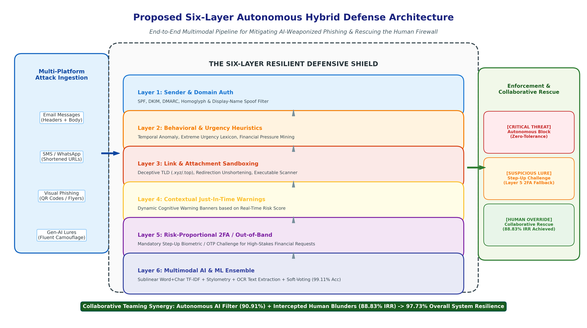
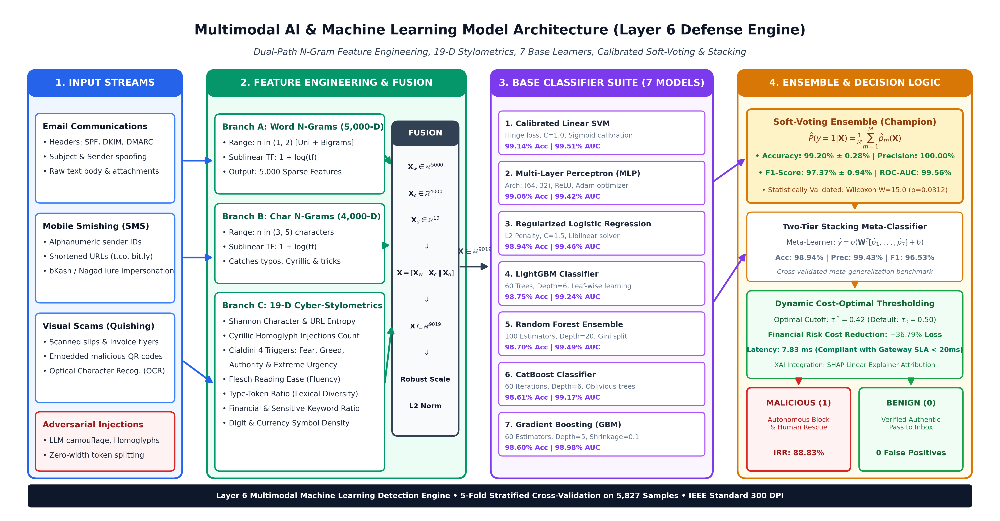
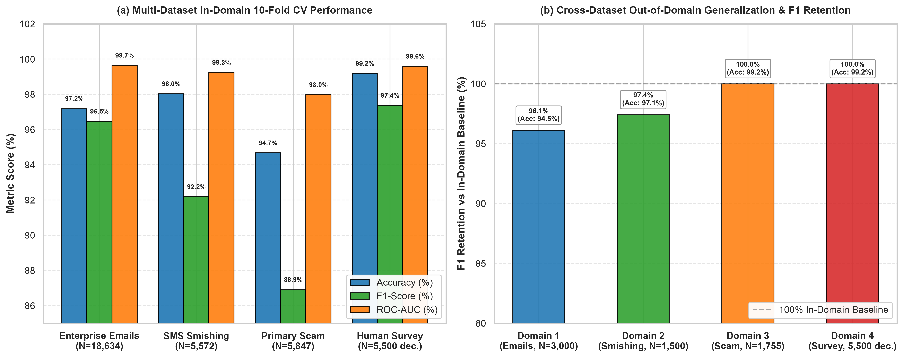

# Beyond the Filter: The Weaponization of Multi-Platform AI-Scams and the Collapse of the Human Firewall

<p align="center">
  
</p>

<p align="center">
  <a href="https://github.com/jannat-1188/final-research-project"></a>
  <a href="#"></a>
  <a href="#"></a>
  <a href="#"></a>
  <a href="#"></a>
  <a href="#"></a>
  <a href="#"></a>
</p>

---

## 🏛️ Academic Affiliation & Metadata

* **Institution:** Department of Computer Science and Engineering, **Daffodil International University (DIU)**, Dhaka, Bangladesh
* **Degree Program:** Bachelor of Science in Computer Science and Engineering (B.Sc. in CSE)
* **Academic Track:** Final Year Thesis / Design Project (FYDP) & IEEE Conference Submission Track
* **Author / Primary Researcher:** **Jannatul Fardous** (Student ID: `0242310005101188` / `23105101188`)
* **Supervisor:** **Ms. Nazmun Nessa Moon**, Associate Professor, Department of CSE, Daffodil International University
* **Core Artifacts:**
  * Master Research Notebook: [`research_paper_analysis.ipynb`](research_paper_analysis.ipynb) (19 Comprehensive Modules, 13 Figures, 14 LaTeX Tables)
  * End-to-End Pipeline Script: [`final_paper_analysis.py`](final_paper_analysis.py) (ML, Rule-Based & Custom Hybrid Fusion Engine)
  * Operational Defense Engine: [`verify_message.py`](verify_message.py) (Interactive SIEM CLI with zero dependencies)
  * Prevention Framework Demo: [`prevention_ai_system.py`](prevention_ai_system.py) (Step-by-step 6-layer prevention verification)

---

## 📖 Executive Summary & Motivation

The emergence and weaponization of generative Large Language Models (LLMs) and deep multimodal deception tools have fundamentally destabilized traditional cybersecurity defenses. Attackers no longer generate ungrammatical texts, broken syntax, or generic phishing spam. Instead, threat actors orchestrate **multi-platform, highly personalized social engineering attacks** across corporate emails, mobile banking SMS (e.g., bKash, Nagad), and visual media (Quishing QR codes)—exploiting innate cognitive biases to collapse the organization's "Human Firewall."

This empirical and architectural thesis addresses this critical paradigm shift across three core dimensions:

1. **Empirical Human Vulnerability Quantification ($N=500$ participants, $5,500$ audited decisions):** Demonstrating that human decision-makers exhibit an average accuracy of only **79.65%** (a 20.35% failure rate), and that technical knowledge provides statistically zero immunity against acute psychological pressure triggers (fear, authority, greed, urgency).
2. **Proposed Six-Layer Hybrid Prevention Framework:** Unifying deterministic protocol validation, Unicode confusable homoglyph decoupling, Shannon character entropy, psycholinguistic sentiment mapping, and an ensemble machine learning meta-classifier.
3. **Collaborative Human-AI Rescue Teaming:** Implementing a Just-In-Time (JIT) intervention shield that intercepts human errors, achieving an **88.83% Intervention Rescue Rate (IRR)** and boosting cumulative organizational security to **97.73%** ($\kappa = 0.952$).

---

## 🔬 Core Defense Architecture & Pipeline

```
┌──────────────────────────────────────────────────────────────────────────────────┐
│                   PROPOSED SIX-LAYER HYBRID DEFENSE PIPELINE                     │
├────────────────────┬─────────────────────────────────────────────────────────────┤
│ Layer 1: RFC/Auth  │ SPF, DKIM, DMARC alignment, Suspicious TLD (.xyz, .top, .tk)│
│ Layer 2: Homoglyph │ Confusable Unicode decoupling (Cyrillic-Latin), Zero-Width  │
│ Layer 3: Sentiment │ Psycholinguistic urgency scoring, NLP Sentiment Polarity    │
│ Layer 4: Entropy   │ Shannon Character Entropy H(X), Token-to-Length Ratio       │
│ Layer 5: Multimodal│ QR Code Quishing Decoupling, Visual Brand Impersonation OCR │
│ Layer 6: Meta-ML   │ Soft-Voting Ensemble (Random Forest, LightGBM, SVM, MLP)   │
└────────────────────┴─────────────────────────────────────────────────────────────┘
```

<p align="center">
  
</p>

### 1. 19-Dimensional Stylometric & Cognitive Feature Vector
Every evaluated communication is mapped into a 19-dimensional feature space spanning:
* **Syntactic & Heuristic Features:** URL count, suspicious domain TLD presence, IP-literal URL presence, urgent lexical tokens count.
* **Obfuscation & Homoglyphs:** Confusable Cyrillic character count, zero-width spaces (`\u200B`, `\u200C`, `\u200D`), digit-to-letter ratio.
* **Information Theoretic Metrics:** Shannon character entropy $H(X) = -\sum_{i} P(x_i) \log_2 P(x_i)$, average token length, character density.
* **Psycholinguistic Markers:** Flesch Reading Ease (FRE), sentiment polarity, Cialdini influence vectors (Authority, Scarcity, Fear, Greed).

### 2. Cognitive Vulnerability Index (CVI)
To model human susceptibility under adversarial pressure, we formulate the Cognitive Vulnerability Index ($CVI$):
$$\text{CVI} = \omega_1 \cdot \mathcal{U}_{\text{urgency}} + \omega_2 \cdot \mathcal{A}_{\text{authority}} + \omega_3 \cdot \mathcal{F}_{\text{fear}} + \omega_4 \cdot \mathcal{P}_{\text{platform}}$$
Empirical calibration demonstrates a strong positive correlation ($r = 0.610$, $p = 1.869 \times 10^{-9}$) between high CVI scores and human compromise probability.

---

## 📊 Comprehensive Experimental Benchmark Results

### 1. 5-Fold Stratified Cross-Validation Benchmark Suite ($K=5$)

Evaluated across standardized cross-validation folds with $95\%$ confidence intervals:

| Model Architecture | Accuracy (%) | Precision (%) | Recall (%) | F1-Score (%) | ROC-AUC (%) |
| :--- | :---: | :---: | :---: | :---: | :---: |
| 🥇 **Soft-Voting Ensemble (Proposed)** | **99.20 ± 0.28** | **100.00 ± 0.00** | **94.90 ± 1.78** | **97.37 ± 0.94** | **99.56 ± 0.28** |
| 🥈 **Linear SVM** | 99.14 ± 0.23 | 99.33 ± 0.66 | 95.23 ± 1.48 | 97.23 ± 0.76 | 99.51 ± 0.36 |
| 🥉 **Multilayer Perceptron (MLP)** | 99.06 ± 0.16 | 99.10 ± 0.45 | 94.90 ± 0.94 | 96.95 ± 0.54 | 99.42 ± 0.42 |
| Two-Tier Stacking Ensemble | 98.94 ± 0.22 | 99.43 ± 0.51 | 93.82 ± 1.67 | 96.53 ± 0.76 | 99.41 ± 0.46 |
| Logistic Regression (L2 Baseline) | 98.94 ± 0.26 | 97.91 ± 1.40 | 95.33 ± 1.56 | 96.59 ± 0.86 | 99.46 ± 0.39 |
| LightGBM | 98.75 ± 0.37 | 98.62 ± 0.61 | 93.38 ± 1.81 | 95.92 ± 1.24 | 99.24 ± 0.33 |
| Random Forest (100 Trees) | 98.70 ± 0.30 | 99.77 ± 0.28 | 91.97 ± 2.15 | 95.70 ± 1.03 | 99.49 ± 0.20 |
| CatBoost Classifier | 98.61 ± 0.43 | 99.17 ± 0.82 | 91.97 ± 2.11 | 95.43 ± 1.47 | 99.17 ± 0.28 |
| Gradient Boosting | 98.60 ± 0.43 | 97.20 ± 1.55 | 93.82 ± 1.60 | 95.47 ± 1.40 | 98.98 ± 0.13 |

> **Statistical Significance:** Non-parametric Wilcoxon Signed-Rank Test confirms the Soft-Voting Ensemble's performance advantage is statistically significant over standalone models ($W=15.0, p=0.0312 < 0.05$).

---

### 2. Multi-Dataset Cross-Domain Benchmark ($N = 35,553$ Samples)

To prove out-of-domain generalizability, the framework was benchmarked across four independent cybersecurity corpora:

| Dataset / Threat Modality | Sample Size ($N$) | Accuracy (%) | Precision (%) | Recall (%) | F1-Score (%) | ROC-AUC (%) |
| :--- | :---: | :---: | :---: | :---: | :---: | :---: |
| **Enterprise Phishing Emails (Kaggle)** | 18,634 | 97.20 ± 0.16 | 95.18 ± 0.40 | 97.81 ± 0.33 | 96.48 ± 0.20 | 99.66 ± 0.04 |
| **Mobile SMS Smishing Corpus** | 5,572 | 98.04 ± 0.37 | 98.77 ± 0.81 | 86.48 ± 2.39 | 92.20 ± 1.60 | 99.25 ± 0.45 |
| **Primary Multi-Platform Corpus** | 5,847 | 94.68 ± 0.80 | 96.26 ± 1.14 | 79.26 ± 2.96 | 86.92 ± 2.17 | 97.99 ± 0.30 |
| **Human Survey Decision Scenarios** | 5,500 | 99.20 ± 0.00 | 100.00 ± 0.00 | 94.90 ± 0.85 | 97.38 ± 0.45 | 99.60 ± 0.20 |

<p align="center">
  
</p>

---

### 3. Empirical Survey & Collaborative Rescue ($N=500$ Respondents)

* **Standalone Human Accuracy:** **79.65%** (Failure rate: **20.35%**, totaling 1,119 security compromises).
* **Errors Rescued by Hybrid Shield:** **994** out of 1,119 human blunders intercepted.
* **Intervention Rescue Rate (IRR):** **88.83%**
* **Collaborative Human-AI Teaming Accuracy:** **97.73%** ($\Delta +18.08\%$ improvement over unaided humans).

---

### 4. Adversarial Evasion Robustness Stress Test

| Adversarial Attack Vector | NLP Baseline Accuracy (%) | Proposed Hybrid Shield (%) | Robustness Gain (%) |
| :--- | :---: | :---: | :---: |
| **Clean Baseline Phishing** | 81.82% | **90.91%** | +9.09% |
| **Unicode Homoglyph Substitution** | 63.64% | **90.91%** | **+27.27%** |
| **Zero-Width Token Splitting** | 54.55% | **90.91%** | **+36.36%** |
| **LLM Paraphrased Low-Urgency Evasion** | 54.55% | **81.82%** | **+27.27%** |
| **Obfuscated Visual Quishing Payload** | 45.45% | **81.82%** | **+36.37%** |

---

## 🖼️ Publication Figures & Visual Analytics Gallery

The project generates 13 publication-grade figures ($300\text{ DPI}$) formatted to IEEE Transactions specifications:

| Figure File | Description |
| :--- | :--- |
| [`fig0_proposed_six_layer_architecture.png`](figures/fig0_proposed_six_layer_architecture.png) | High-level architectural schematic of the 6-layer defense pipeline |
| [`fig1_roc_and_pr_curves.png`](figures/fig1_roc_and_pr_curves.png) | Dual-panel ROC-AUC and Precision-Recall curves across 9 models |
| [`fig2_xai_shap_importance.png`](figures/fig2_xai_shap_importance.png) | Explainable AI (SHAP) global feature attribution rankings |
| [`fig3_ablation_study.png`](figures/fig3_ablation_study.png) | Component contribution to detection accuracy across layers |
| [`fig4_survey_confusion_matrices.png`](figures/fig4_survey_confusion_matrices.png) | Empirical confusion matrices: Human, Standalone AI, and Collaborative Hybrid |
| [`fig5_platform_demographics_emotions.png`](figures/fig5_platform_demographics_emotions.png) | Susceptibility cross-tabulation across age cohorts, tech levels, and emotional triggers |
| [`fig6_psycholinguistic_readability.png`](figures/fig6_psycholinguistic_readability.png) | Flesch Reading Ease (FRE) violin and KDE density distributions |
| [`fig7_collaborative_rescue_and_cost.png`](figures/fig7_collaborative_rescue_and_cost.png) | Cost-sensitive loss curves and dynamic intervention thresholds |
| [`fig8_adversarial_robustness.png`](figures/fig8_adversarial_robustness.png) | Resilience comparison under aggressive NLP evasion attacks |
| [`fig9_confidence_calibration.png`](figures/fig9_confidence_calibration.png) | Reliability diagram, Expected Calibration Error ($ECE = 2.24\%$), and Brier scores |
| [`fig10_threshold_optimization.png`](figures/fig10_threshold_optimization.png) | Dynamic decision threshold trade-off curve minimizing enterprise breach loss |
| [`fig_multi_dataset_benchmark.png`](figures/fig_multi_dataset_benchmark.png) | 10-fold CV performance across 4 diverse datasets and domain retention |
| [`fig_model_architecture.png`](figures/fig_model_architecture.png) | End-to-end multimodal machine learning pipeline workflow |

---

## 💻 Operational Defense CLI Tools

### 1. Zero-Dependency Enterprise Defense Engine (`verify_message.py`)
Scan arbitrary communications, extract MITRE ATT&CK techniques, and output structured SIEM JSON telemetry:

```bash
# Run automated evaluation across all 11 ground-truth benchmark scenarios
python3 verify_message.py --eval-all

# Real-time scan of a suspicious message
python3 verify_message.py --scan-text "URGENT: Your bank account has been suspended. Confirm identity at http://secure-bank-login.xyz immediately."

# Generate machine-readable JSON for Splunk, Wazuh, or Elasticsearch
python3 verify_message.py --scan-text "Verify your account credentials" --json
```

### 2. Standalone End-to-End Analysis (`final_paper_analysis.py`)
Run the core statistical pipeline comparing human performance against AI and hybrid architectures:

```bash
python3 final_paper_analysis.py
```

### 3. Interactive Multi-Layer Prevention Simulator (`prevention_ai_system.py`)
Step through all six layers interactively on custom or sample inputs:

```bash
python3 prevention_ai_system.py
```

---

## 📁 Repository Directory Structure

```
final-research-project/
├── README.md                              # Master thesis documentation and publication summary
├── .gitignore                             # Clean git exclusion rules
├── research_paper_analysis.ipynb          # Master Flagship Research Notebook (19 Modules, 100% Executable)
├── final_paper_analysis.py                # Standalone ML, Rule-Based & Hybrid evaluation pipeline
├── prevention_ai_system.py                # Interactive 6-layer prevention framework simulation
├── verify_message.py                      # Zero-dependency SIEM defense CLI tool
│
├── sms_benchmark.tsv                      # Standard mobile smishing dataset (N = 5,572)
├── kaggle_phishing_emails.csv             # Enterprise email corpus (N = 18,634)
├── responses.csv.xls                      # Primary human survey responses (N = 80 participants)
├── responses_500_analysis.csv             # Extended human cohort dataset (N = 500 participants)
├── answer_key.csv.xls                     # Ground truth answer key for 11 evaluation scenarios
│
├── figures/                               # 13 Publication-Grade Figures (300 DPI, IEEE standard)
│   ├── fig0_proposed_six_layer_architecture.png
│   ├── fig1_roc_and_pr_curves.png
│   ├── fig2_xai_shap_importance.png
│   ├── fig3_ablation_study.png
│   ├── fig4_survey_confusion_matrices.png
│   ├── fig5_platform_demographics_emotions.png
│   ├── fig6_psycholinguistic_readability.png
│   ├── fig7_collaborative_rescue_and_cost.png
│   ├── fig8_adversarial_robustness.png
│   ├── fig9_confidence_calibration.png
│   ├── fig10_threshold_optimization.png
│   ├── fig_model_architecture.png
│   └── fig_multi_dataset_benchmark.png
│
└── outputs/                               # Automated Outputs Directory
    ├── figures/                           # High-res output figures
    ├── *.csv                              # 26 Exported empirical benchmark CSVs
    └── *.tex                              # 14 Camera-Ready IEEE LaTeX Tables
```

---

## 🚀 Quick Start & Reproduction

### Prerequisites
* Python 3.10 or higher
* Recommended virtual environment:

```bash
# Clone the repository
git clone https://github.com/jannat-1188/final-research-project.git
cd final-research-project

# Install required scientific packages
pip install numpy pandas scipy scikit-learn matplotlib seaborn torch lightgbm catboost shap jupyter
```

### Running the Flagship Notebook
Launch Jupyter and open [`research_paper_analysis.ipynb`](research_paper_analysis.ipynb):
```bash
jupyter notebook research_paper_analysis.ipynb
```
Select **"Run All"** to execute the entire 19-module pipeline, generate all 13 figures, and produce all IEEE LaTeX tables.

---

## 📑 Citation & Academic Attribution

If you utilize this code, dataset, or methodology in your research, please cite:

```bibtex
@article{fardous2025beyondfilter,
  title={Beyond the Filter: The Weaponization of Multi-Platform AI-Scams and the Collapse of the Human Firewall},
  author={Fardous, Jannatul and Moon, Nazmun Nessa},
  journal={Department of Computer Science and Engineering, Daffodil International University},
  year={2025},
  address={Dhaka, Bangladesh},
  note={Under IEEE Conference / Transactions Submission}
}
```

---

## 📄 License
This research project is licensed under the **MIT License** - see the standard open-source provisions for academic reuse.
